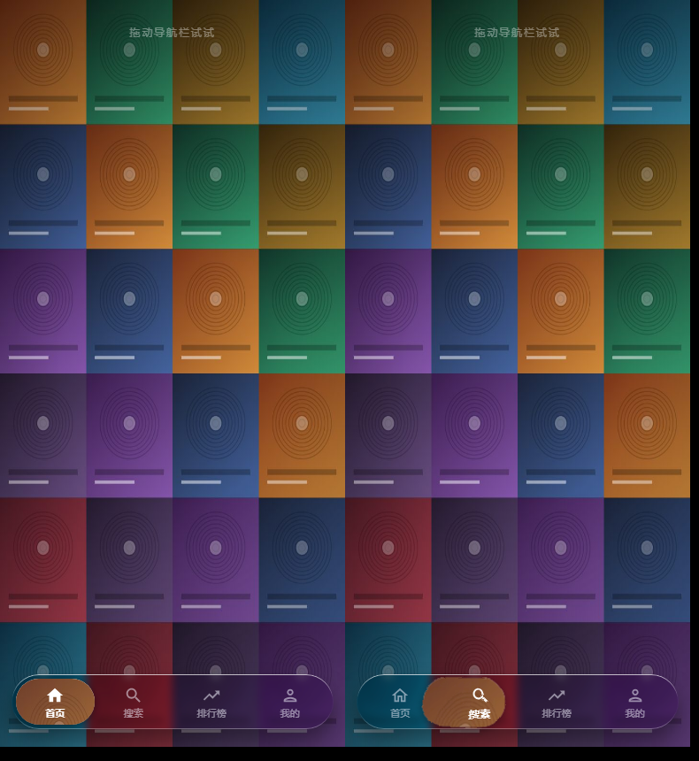

# liquid-glass-dock

复刻 **液态玻璃（Liquid Glass）悬浮药丸导航栏** 的可落地实现 —— 半透明毛玻璃底、可拖动带惯性的胶囊指示器、选中项从玻璃里「透」出来、按住时边缘折射凸起。

同一套视觉规格给了两份可直接跑的实现：**Jetpack Compose（AGSL 真折射）** 与 **单文件网页（backdrop-filter 近似）**。



> 左：静止态，指示器为平面玻璃，只把选中态清晰贴出来　右：按压态，指示器放大、文字被折射扭曲

## 特性

- **双绘 + 锐利采样**：同一排图标文字画两遍，选中态那一遍只录进纹理不显示，指示器的玻璃去采样这张纹理，于是选中项在玻璃里是清晰的、周围是模糊的。
- **真折射**：AGSL `RuntimeShader` 做圆角矩形内的双曲折射 + 三通道色散 + 菲涅尔边缘高光，不是假的渐变描边。
- **跟手拖动**：`rubberbandClamp` 橡皮筋限位、速度投射（`projectFling`）预测落点、松手带初速的弹簧收尾，慢拖和快甩手感不同。
- **按压形变**：1 → 1.08 缩放，叠加按速度而成的横向拉伸（≤16%），同时驱动折射强度。
- **分级降级**：API < 33 自动退化为高斯模糊 + 内描边，视觉不塌。

## 目录

```
SKILL.md                     Agent 技能说明（平台路由 / 落地步骤 / 不可乱改的参数）
assets/compose/GlassDock.kt  自包含 Compose 实现，改首行包名即可用
assets/web/glass-dock.html   单文件网页实现，双击打开即可拖动、按压
references/spec.md           完整视觉规格、动效曲线、降级矩阵、自检清单
references/adapt.md          改成 3/5 入口、接 Navigation-Compose、换主题色、方形变体、性能与坑
```

## 拿去用

### Compose

1. 把 `assets/compose/GlassDock.kt` 拷进目标项目 `ui/` 目录，**改掉首行 `package`**。
2. 依赖：Compose 1.7+（`rememberGraphicsLayer` / `GraphicsLayer.renderEffect`）、Material3。minSdk 21 可编译，玻璃需 API 31，折射需 API 33。
3. 页面顶层建采样源，主体走 `backdropSource`，导航栏采样它：

```kotlin
val backdrop = rememberBackdropSource()
Box(Modifier.fillMaxSize()) {
    MainContent(Modifier.fillMaxSize().backdropSource(backdrop))
    LiquidGlassDock(
        items = listOf(
            DockItem("首页", Icons.Outlined.Home, Icons.Rounded.Home),
            DockItem("搜索", Icons.Outlined.Search, Icons.Rounded.Search),
            DockItem("排行榜", Icons.Outlined.TrendingUp, Icons.Rounded.TrendingUp),
            DockItem("我的", Icons.Outlined.Person, Icons.Rounded.Person),
        ),
        selectedIndex = selected,
        onSelect = { selected = it },
        source = backdrop,
        modifier = Modifier.align(Alignment.BottomCenter).padding(bottom = 20.dp),
    )
}
```

排错三连：**纯色板** = `source` 没接上或主体没走 `backdropSource()`；**有毛玻璃没折射** = API < 33 或 `liquid = false`（预期降级）；**指示器在但选中项不亮** = `accent` 与主题 primary 不一致。

### Web

直接打开 `assets/web/glass-dock.html`。嵌进项目时保留三层：`dock`（blur + 内描边）→ `ind`（清晰副本 + 高光 + 可选 `filter: url(#lens)`）→ `ind-track`（跟随指示器反向位移的选中态内容）。

**对齐是唯一致命点**：指示器里的背景副本必须用与页面完全相同的背景，并加 `background-attachment: fixed` + 视口单位尺寸（`100vw 100vh`）。尺寸一用百分比，副本就会和真背景错开。

## 参数（别单独改）

这些数字是配平过的，动一个就要连带改另外两个，完整推导见 `references/spec.md`。

| 项 | 值 |
|---|---|
| 条高 / 内距 | 62dp / 5dp |
| 每格宽 | `clamp(64dp, (屏宽-36)/格数, 92dp)` |
| 外圆角 | 条高 ÷ 2 = 31dp |
| 指示器圆角 | (高 − 2×内距) ÷ 2 = 26dp |
| 外玻璃 | blur 5dp、saturate 1.5、tint 深色 #000 24%／浅色 #fff 34%、折射 24dp、开色散 |
| 指示器玻璃 | 折射 12dp / 16dp、白高光 .85、叠 13% 主题色、无阴影 |
| 位移弹簧 | damping .72 / stiffness 380 |
| 松手弹簧 | damping .86 / stiffness 420，带初速 |

三条容易踩反的：

1. 药丸圆角恒等于高度的一半；指示器圆角恒等于 `(高 − 2×内距) ÷ 2`。两者不独立。
2. **模糊要小**。加到 20dp 以上就成毛玻璃板，透不出背后的封面色；浓度靠 tint 的 alpha 撑，通透感靠折射撑。
3. 指示器的 `lensProgress` 绑按压进度，**不是常数**。写成 `{ 1f }` 会让整条导航永远糊一层扭曲。

## 当作 WorkBuddy 技能安装

```bash
cd ~/.workbuddy/skills
unzip liquid-glass-dock.zip   # 或直接把本仓库 clone 成 liquid-glass-dock/
```

之后在对话里说「用 liquid-glass-dock 给我做个一样的底部导航栏」即可触发。

## License

MIT
